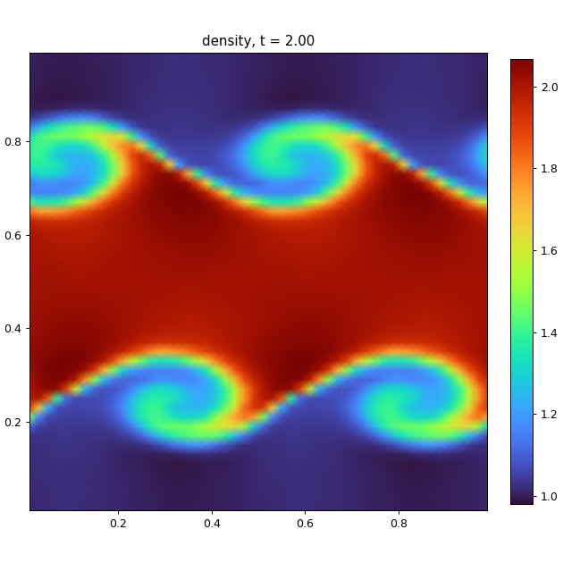
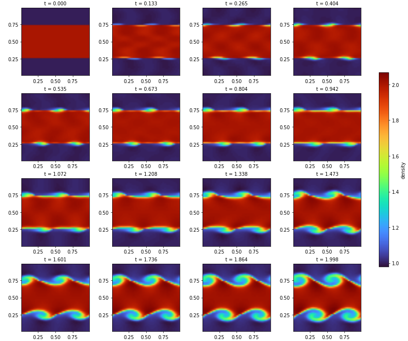
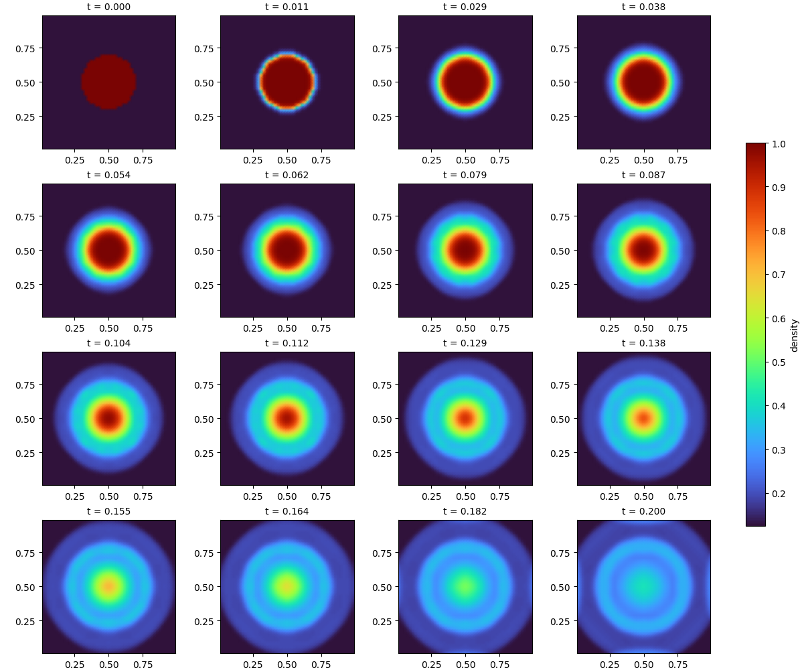
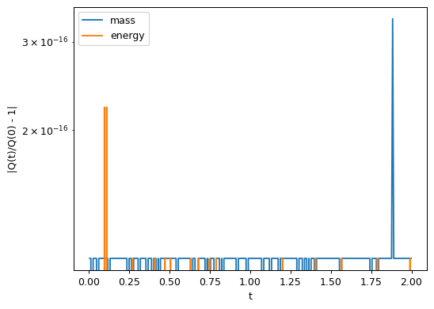

# 2D Godunov / HLLC Hydrodynamics Solver

A compact 2D finite-volume solver for the compressible Euler equations, written from scratch in Python/NumPy. The scheme is formally second-order accurate in space and time (MUSCL-type reconstruction + two-stage Runge–Kutta).



## Method

- **Riemann solver:** HLLC (Toro 1999, ch. 10), with Davis wave-speed estimates (Toro eq. 10.38)
- **Reconstruction:** piecewise-linear (MUSCL-type) with the MinMod slope limiter
- **Time integration:** explicit two-stage second-order Runge–Kutta (Toro eq. 15.36), CFL-limited time step
- **Grid and boundary conditions:** cell-centred grid on [0, L] × [0, W] with M × N cells; periodic in x (along the flow), reflecting (rigid) walls in y; ghost cells carry both the values and the reconstruction slopes. Rectangular domains are supported.

## Initial conditions

Selected with the `IC` argument of `Godunov2`:

| Function | Problem |
|---|---|
| `IC_kh_springel` (default) | Kelvin–Helmholtz instability, setup of Springel (2010): a dense band (ρ = 2, u = +0.5) between lighter layers (ρ = 1, u = −0.5) in pressure equilibrium, with a single-mode velocity perturbation at the interfaces |
| `IC_kh_sharp` | Kelvin–Helmholtz with a sharp, sinusoidally displaced interface |
| `IC_sod_explosion` | Circular 2D Sod-type explosion (use γ = 1.4) |





## Verification

Three checks. The first two each caught a real bug during development:

- **Conservation.** In a closed box (periodic + reflecting walls) total mass and energy must be conserved to round-off. They are, to ~10⁻¹⁶ relative. Before the ghost-cell slopes were given proper boundary conditions, the drift reached ~3×10⁻⁴ by t = 2.

  

- **Advection** (`test_advection.py`). A density wave advected at uniform velocity u₀ must move exactly u₀·t. Measured/expected displacement: **1.001**. This test exposed an error in the Runge–Kutta stage combination that had made the solution advance 1.5× faster than the reported time.

- **All initial conditions** (`test_initial_conditions.py`). Every IC is run briefly on a square and on a rectangular domain; the test checks for NaNs, conservation to round-off, and (for the explosion) mirror symmetry to round-off.

## Usage

```bash
pip install numpy matplotlib
python godunov2d.py          # KH run: density snapshots and conservation plot
python test_advection.py     # time-integration check, prints the displacement ratio
python test_initial_conditions.py   # smoke test of all ICs, prints PASS/FAIL
```

Run parameters are set in the call to `Godunov2(gamma, L, W, M, N, c, t_end, IC=...)` at the bottom of `godunov2d.py`: adiabatic index, box size L × W, number of cells M × N, CFL number, end time and initial condition. A 50×50 run to t = 2 takes a few minutes, since the flux loops are plain Python.

## Known issues and planned work

- The time step is set from min(Δx, Δy)/(|**v**| + a); the stricter unsplit-2D CFL condition (summing the contributions of both directions) has not yet been checked.
- Planned: a convergence-order study to measure the actual order of accuracy, vectorised flux computation, gravity source terms (Rayleigh–Taylor instability).

## References

- E. F. Toro, *Riemann Solvers and Numerical Methods for Fluid Dynamics: A Practical Introduction*, 2nd ed., Springer (1999).
- V. Springel, "E pur si muove: Galilean-invariant cosmological hydrodynamical simulations on a moving mesh", *MNRAS* 401, 791 (2010).

## License

MIT, see [LICENSE](LICENSE).
